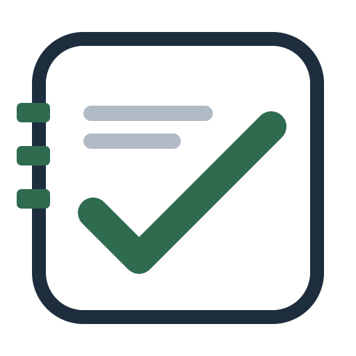

  

<h1 align="center">Digitales Register</h1>

  Dein Schulalltag auf einen Blick. 
  Inoffizielle App für das Digitale Register in Südtirol – entwickelt mit Flutter.

  
  
  

## Die App

Noten, Termine und Mitteilungen an einem Ort – auf dem Smartphone, Tablet oder Windows-PC. Melde dich mit deinem bestehenden Schulkonto an.

- **Überblick behalten:** Noten und ihre Entwicklung einsehen.
- **Schulalltag planen:** Stundenplan, Kalender und Hausaufgaben im Blick behalten.
- **Informiert bleiben:** Mitteilungen des Registers lesen.
- **Persönlich einrichten:** Helles oder dunkles Design wählen.
- **Mehrsprachig nutzen:** Deutsch, Italienisch, Englisch und Ladinisch.
- **Unterlagen mitnehmen:** Unter Einstellungen → Daten exportieren geladene Zeugnisse, Noten, Nachrichten, Stundenplan, Prüfungen, Aufgaben, Abwesenheiten und Unterrichtsinhalte als PDF oder CSV speichern. Mehrere Kategorien ergeben ein gemeinsames PDF oder ein ZIP mit CSV-Dateien.

## Ausprobieren

Ohne Schulkonto kannst du die App mit lokalen Beispieldaten kennenlernen: Schule leer lassen und als Benutzername und Passwort jeweils **`demo`** eingeben.

## Über das Projekt

Diese App ist ein unabhängiges, inoffizielles Projekt für [digitalesregister.it](https://digitalesregister.it). Sie basiert auf dem [Originalprojekt von miDeb](https://github.com/miDeb/digitales_register) und wird in diesem Fork weiterentwickelt.

Fehler gefunden oder eine Idee? Erstelle ein [Issue](https://github.com/Tobias-Bucci/digitales_register/issues). Beiträge per Pull Request sind willkommen.

## Entwicklung & Datenschutz

Technische Details stehen in der Dokumentation: [iOS](docs/IOS_RELEASE_READINESS.md), [Linux](docs/LINUX_RELEASE_READINESS.md) und [Windows-Buildskript](tool/build_windows_store.ps1).

Informationen zum Umgang mit Daten findest du in der [Datenschutz-Dokumentation](docs/PRIVACY_AUDIT_V4.md) und der [Datenübersicht](docs/PRIVACY_DATA_INVENTORY.md).

## Lizenz

Veröffentlicht unter der [GNU General Public License v3.0](LICENSE.txt).
